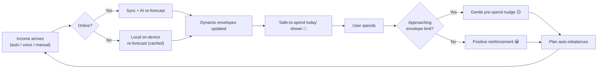
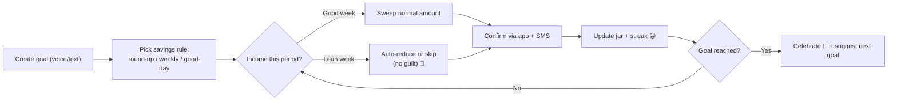
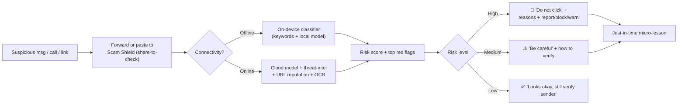
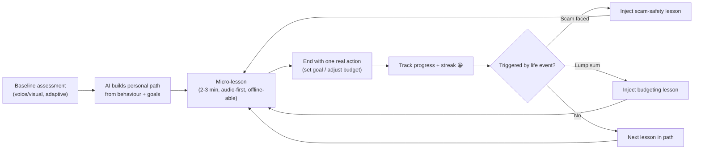

# 03 — User Journeys

Four end-to-end journeys mapped as experience tables (Activities · Thoughts · Pain points · Opportunities) plus a Mermaid flow for each. Journeys are written against the personas in [02](02-user-personas.md).

Legend for emotion in flows: 😟 frustrated · 😐 neutral · 🙂 reassured · 😀 confident

---

## Journey A — Budgeting (irregular income)
*Primary persona: Thandi (gig driver) / Carlos (freelancer)*

| Stage | Activities | Thoughts | Pain points | Opportunities |
|-------|-----------|----------|-------------|---------------|
| **1. Capture income** | Logs a day's earnings (auto-imported payout or manual/voice entry) | "I made R420 today, but is that good?" | Manual entry is tedious; cash income invisible to banks | Auto-ingest payouts via connectors; voice/one-tap entry; smart categorisation |
| **2. See reality** | Opens dashboard, sees rolling 7/30-day income & spend | "Where did it all go?" | Monthly budgets don't fit daily/lumpy income | **Dynamic envelopes** recalculated on each income event, not monthly |
| **3. Get a plan** | AI suggests "safe-to-spend today" and allocations to bills/goals | "Can I trust this number?" | Generic advice ignores volatility | Volatility-aware forecasting; plain-language, explainable allocation |
| **4. Spend within plan** | Spends; app nudges before overspend | "Am I about to go over?" | Nudges can feel naggy / arrive too late | Pre-transaction nudge; positive reinforcement on good days |
| **5. Adjust** | Bad day happens; plan auto-rebalances | "A slow day won't wreck me?" | Rigid budgets break on one bad day | Auto re-forecast; "catch-up, not guilt" messaging |

**Key design decisions driven by this journey:** income-event-triggered re-forecasting (not calendar-month), on-device forecasting for offline, pre-transaction (not post-hoc) nudges.

---

## Journey B — Saving (micro-savings & goals)
*Primary persona: Maria (domestic worker) / Sipho (seasonal)*

| Stage | Activities | Thoughts | Pain points | Opportunities |
|-------|-----------|----------|-------------|---------------|
| **1. Set a goal** | Creates "School fees — R2,000 by Jan" via voice | "I never manage to save." | Big goals feel impossible | Break into tiny weekly targets; visual jar fills up |
| **2. Choose a rule** | Picks round-ups / fixed weekly / "save on good days" | "What if I can't afford it this week?" | Fixed debits fail on bad weeks | **Affordability-aware** auto-save; skips/reduces on low-income weeks |
| **3. Auto-save** | App sweeps small amounts automatically | "Did it actually work?" | No visibility / trust in automation | Instant confirmation (SMS too); running "saved so far" |
| **4. Stay motivated** | Gets streaks, milestones, encouragement | "I'm actually doing it!" | Motivation fades | Streaks, milestone celebrations, community-style nudges (opt-in) |
| **5. Protect & withdraw** | Needs emergency access but is warned before raiding goals | "Can I take it out if I must?" | Locked savings cause distrust; or too-easy raiding defeats purpose | Soft-lock with friction + "are you sure?"; separate emergency fund |

**Key design decisions:** affordability-aware sweeps (never overdraw a vulnerable user), SMS confirmation for feature-phone trust, friction on withdrawals to protect discipline without locking people out.

---

## Journey C — Scam Detection (Scam Shield)
*Primary persona: all — especially Grace, Maria, Sipho*

| Stage | Activities | Thoughts | Pain points | Opportunities |
|-------|-----------|----------|-------------|---------------|
| **1. Encounter** | Receives suspicious SMS/WhatsApp link, call, or "investment" offer | "Is this real? It looks official." | Scams are sophisticated & localised | On-device + cloud scam classifier; share-to-check |
| **2. Check** | Pastes/forwards message or screenshot to Scam Shield | "I don't want to feel stupid asking." | Shame; no trusted second opinion | Judgement-free "let's check together" tone; image OCR of screenshots |
| **3. Verdict** | Gets risk rating + plain-language reasons | "Why is it risky?" | Opaque "blocked" messages aren't trusted | **Explainable** verdict: the 3 red flags it found, in the user's language |
| **4. Act** | Guided: don't click, report, block, warn contacts | "What do I do now?" | Users don't know next steps | One-tap report to authority/telco; share warning to contacts |
| **5. Learn** | Micro-lesson on that scam type | "I'll spot it next time." | Repeat victimisation | Just-in-time literacy tied to the real threat they just faced |

**Key design decisions:** on-device fallback so protection works offline, explainable verdicts (red flags not black-box), judgement-free tone, threat-intel + crowd reports feeding model retraining.

---

## Journey D — Financial Learning (Literacy Coach)
*Primary persona: Grace, Maria (low literacy) / Carlos (wants depth)*

| Stage | Activities | Thoughts | Pain points | Opportunities |
|-------|-----------|----------|-------------|---------------|
| **1. Assess** | Short, friendly baseline quiz (voice-answerable) | "Will this make me feel dumb?" | Fear of judgement; literacy barrier | Adaptive, voice/visual assessment; encouraging framing |
| **2. Personalise** | Coach builds a path from real behaviour + goals | "Is this relevant to *my* money?" | Generic curricula feel abstract | Lessons tied to the user's actual budget/goals/scam events |
| **3. Learn in bite sizes** | 2–3 min audio/visual lessons, low-data | "I only have a few minutes & little data." | Long, text-heavy, data-hungry content | Micro-lessons, downloadable for offline, audio-first |
| **4. Apply** | Prompted to take one small action (e.g., set a goal) | "What do I actually *do*?" | Knowledge ≠ behaviour change | Each lesson ends in a one-tap action inside the app |
| **5. Progress** | Earns progress, unlocks next, celebrates | "I'm getting better with money." | No sense of progress | Visible path, streaks, certificates (shareable, builds pride) |

**Key design decisions:** lessons are contextual (triggered by real events in Journeys A–C), audio-first & offline-downloadable, every lesson ends in an in-app action to drive behaviour change.

---

## Cross-journey insight → architecture

These journeys collectively mandate the following architectural requirements (traced into [System Architecture](05-system-architecture.md)):

1. **Offline-first & event-driven** — forecasting, saving rules, and scam checks must degrade gracefully offline (local models + sync queue).
2. **Voice & multilingual at every entry point** — not a bolt-on; the API and UI assume voice/vernacular input.
3. **Explainability as a product feature** — the AI services must emit human-readable reasons, not just scores.
4. **Life-event bus** — income events, scam checks, and goal milestones trigger budgeting, saving, and learning. This is the backbone for an event-driven microservice design.

---

**Related:** [Feature List](04-feature-list.md) · [System Architecture](05-system-architecture.md) · [AI Module Design](08-ai-module-design.md)
