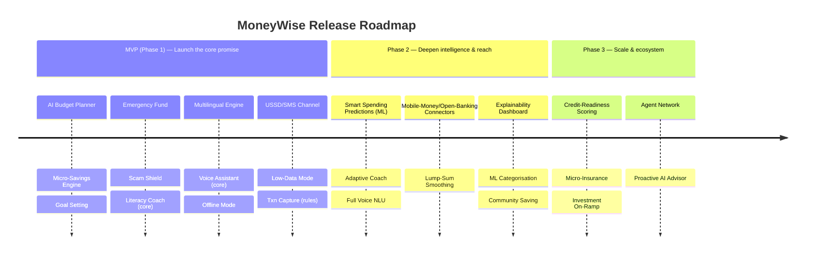

# 04 — Feature List & Roadmap

Features are catalogued with a description, the persona pains they address, and a release phase. Prioritisation uses a RICE-informed MoSCoW within three phases.

- **MVP (Phase 1)** — the smallest set that delivers the core promise *simpler + safer + reachable* and is demo-able / launchable.
- **Phase 2** — deepens engagement, intelligence, and reach.
- **Phase 3** — scale, ecosystem, and advanced AI.

---

## Feature catalogue

### 1. AI Budget Planner  — **MVP**
Dynamic, income-event-driven budgeting for irregular earners. Builds adaptive "envelopes" and a daily **safe-to-spend** figure that re-forecasts whenever income or spend changes.
- **Pains:** irregular income, limited literacy.
- **AI:** volatility-aware forecasting + LLM plain-language explanation. See [AI Design §Budget](08-ai-module-design.md#1-budget-recommendation-engine).

### 2. Smart Spending Predictions — **MVP (basic) → Phase 2 (advanced)**
Forecasts upcoming expenses and lean periods; warns of likely shortfalls before they happen.
- MVP: rule + simple time-series on recurring expenses.
- Phase 2: ML seasonality/anomaly model, "lean week ahead" alerts.
- **Pains:** irregular income, savings discipline.

### 3. Micro-Savings Engine — **MVP**
Automated, **affordability-aware** savings: round-ups, fixed weekly, or "save on good days." Skips/reduces on low-income weeks. SMS-confirmed.
- **Pains:** savings discipline, irregular income.

### 4. Goal Setting — **MVP**
Create goals (school fees, stock, car repair) broken into tiny achievable targets with visual progress ("jars"), streaks, and milestones.
- **Pains:** savings discipline, motivation.

### 5. Emergency Fund Tracking — **MVP**
A dedicated, soft-locked buffer with a coverage metric ("X weeks of expenses covered"). Guided top-ups; friction on withdrawal.
- **Pains:** financial shocks, resilience.

### 6. Scam Shield — **MVP**
Share-to-check for suspicious SMS/WhatsApp/links/screenshots. Returns an **explainable** risk verdict (top red flags) with guided next steps (report/block/warn). On-device fallback for offline.
- **Pains:** scam exposure, low literacy.
- **AI:** scam classifier + URL reputation + OCR. See [AI Design §Scam](08-ai-module-design.md#3-scam-detection-engine).

### 7. Financial Literacy Coach — **MVP (core) → Phase 2 (adaptive)**
Personalised, contextual micro-lessons (2–3 min, audio-first, offline-downloadable). Each ends in a real in-app action. Triggered by life events (scam faced, lump sum received).
- **Pains:** limited literacy, language barriers.

### 8. Multilingual Translation Engine — **MVP**
UI, content, voice, and AI responses in local languages. Lesson/scam content localised, not just translated.
- **Pains:** language barriers.

### 9. Voice-First Assistant — **MVP (core intents) → Phase 2 (full NLU)** ⭐ *flagship differentiator*
Voice as the *primary* interface for low-literacy users, not an add-on: log income/expense, "how much can I spend?", create goal, check a scam, "how's my health score?". **Built** in the web demo via the Web Speech API; Azure AI Speech + `/voice/intent` in production. See [Differentiators §2](16-differentiators.md#2-voice-first-financial-assistant).
- **Pains:** literacy, accessibility, language barriers.

### 10. Offline Mode — **MVP**
Offline-first app: local cache, on-device models for budgeting & scam checks, sync queue. Core journeys never require a live connection.
- **Pains:** low connectivity, expensive data.

### 11. USSD / SMS Channel — **MVP (reach requirement)**
Full feature-phone experience for savings, balance, goals, and scam-tip SMS. Non-negotiable for financial inclusion (serves Sipho/Grace).
- **Pains:** no smartphone, low connectivity.

### 12. Low-Data Mode — **MVP**
Aggressive payload compression, delta sync, image-free fallbacks, cached content. Minimises user data cost.
- **Pains:** expensive mobile data.

### 13. Transaction Capture & Categorisation — **MVP → Phase 2**
Manual/voice/photo capture; MVP rule-based categorisation, Phase 2 ML auto-categorisation; business-vs-personal tagging (for traders).
- **Pains:** irregular income tracking, trader profit visibility.

### 14. Open Banking / Mobile-Money Connectors — **Phase 2**
Auto-ingest from mobile money (M-Pesa etc.) and bank/payout APIs where available, reducing manual entry.
- **Pains:** manual entry friction.

### 15. Lump-Sum Smoothing ("Personal Salary") — **Phase 2**
Allocates a windfall across future weeks + goals + tax/lean-period provisions to simulate a steady income.
- **Pains:** feast-or-famine (Carlos).

### 16. Advanced Explainability Dashboard — **Phase 2**
"Why did the AI suggest this?" views, counterfactuals ("if you saved R10 less..."), trust controls.
- **Pains:** AI distrust.

### 17. Community Savings Circles (opt-in) — **Phase 2** ⭐ *flagship differentiator*
Digitised savings groups (stokvel/chama/ROSCA) with a transparent ledger, fair rotation, automated reminders, and scam protection built in. See [Differentiators §3](16-differentiators.md#3-community-savings-circles-digitised-stokvels--chamas--roscas).
- **Pains:** trust, motivation, replacing risky informal groups.
- **Why it wins:** meets users in behaviour they already trust; social accountability is the strongest retention driver; each organiser recruits a whole group (viral, low CAC).

### 17a. AI Financial Health Score — **MVP** ⭐ *flagship differentiator*
An inclusion-friendly alternative to a credit score: four explainable pillars (savings consistency, financial resilience, budget adherence, income stability) → a 0–100 score and band that users can see and improve. **Built** in the reference backend (`GET /v1/health-score`). See [Differentiators §1](16-differentiators.md#1-ai-financial-health-score).
- **Pains:** financial exclusion, lack of trust, no formal credit record.

### 18. Credit-Readiness & Alternative Scoring — **Phase 3**
Builds an alternative creditworthiness profile from savings/budgeting behaviour (user-consented) to unlock fair credit.
- **Pains:** exclusion from formal credit.

### 19. Micro-Insurance Marketplace — **Phase 3**
Partner-provided affordable insurance (funeral, health, asset) surfaced contextually.
- **Pains:** vulnerability to shocks.

### 20. Investment On-Ramp (micro) — **Phase 3**
Fractional, low-minimum savings/investment products via partners.
- **Pains:** wealth-building access.

### 21. Agent / Super-App Network — **Phase 3**
Human agent network + partner embedding for assisted onboarding in low-trust/low-literacy communities.
- **Pains:** trust, digital access.

### 22. Proactive AI Financial Advisor — **Phase 3**
Conversational advisor that proactively flags opportunities/risks across the full financial picture.
- **Pains:** lack of personalised advice.

---

## Roadmap summary

## MVP scope guardrails

The MVP is deliberately protective and reachable:
- **Must run offline and on a feature phone** (USSD/SMS + offline app).
- **Must speak the user's language and accept voice.**
- **Must actively protect** (Scam Shield) from day one — safety is not a later phase.
- **Must explain itself** — even MVP AI outputs carry plain-language reasons.

## Prioritisation rationale (RICE highlights)

| Feature | Reach | Impact | Confidence | Effort | Phase |
|---|:--:|:--:|:--:|:--:|:--:|
| AI Budget Planner | High | High | Med | High | MVP |
| Micro-Savings Engine | High | High | High | Med | MVP |
| Scam Shield | High | High | Med | Med | MVP |
| USSD/SMS Channel | Med | High | High | Med | MVP |
| Offline Mode | High | High | Med | High | MVP |
| Mobile-Money Connectors | Med | High | Low | High | P2 |
| Credit-Readiness | Med | High | Low | High | P3 |

---

**Related:** [User Journeys](03-user-journeys.md) · [System Architecture](05-system-architecture.md) · [AI Module Design](08-ai-module-design.md)
