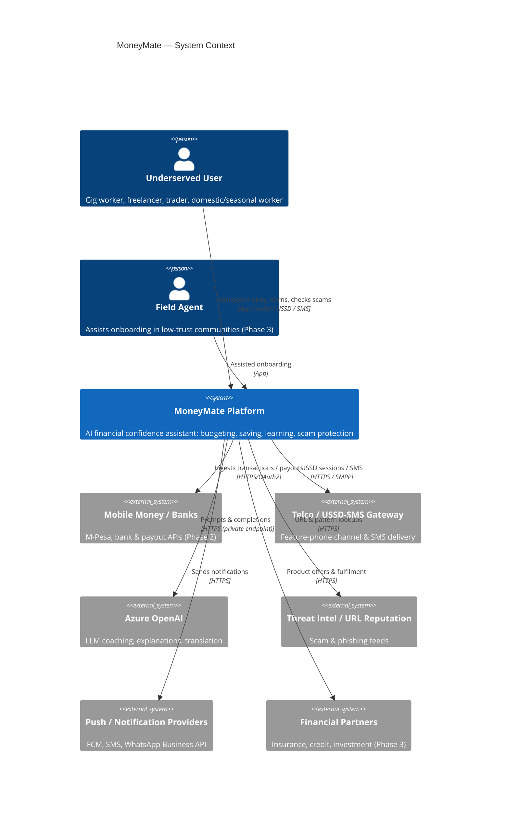
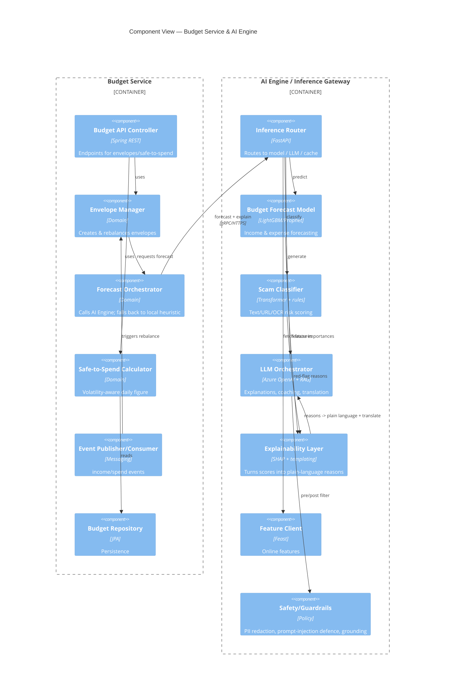
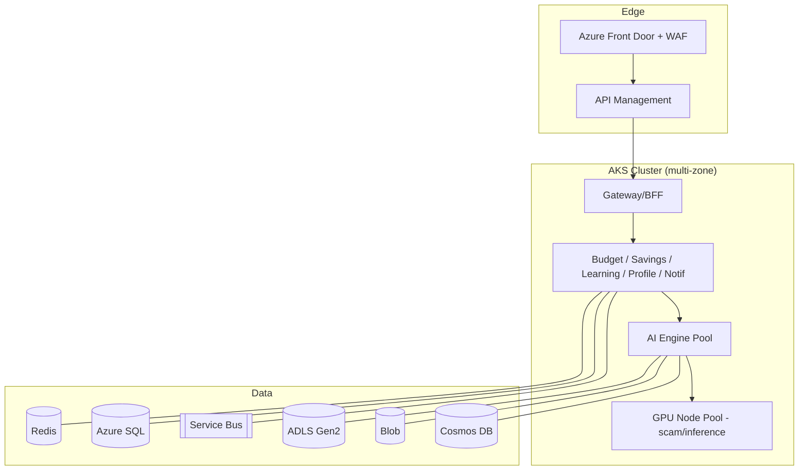

# 05 — System Architecture

**Architecture style:** Cloud-native **microservices**, **event-driven** (choreography via a message bus for life-events), **offline-first clients**, **API-gateway** edge, polyglot persistence. Rendered as the C4 model: Context → Container → Component.

Guiding non-functional requirements (NFRs): offline tolerance, low-data payloads, multilingual/voice at the edge, explainable AI, Zero-Trust security, horizontal scalability, cost-to-serve < $0.08/user/month.

---

## C4 Level 1 — System Context

**External dependencies are isolated behind adapters** so the core is not coupled to any single telco, bank, or AI vendor (see [ADR-0005](adr/0005-vendor-abstraction.md)).

---

## C4 Level 2 — Containers

```mermaid
C4Container
    title MoneyMate — Container Diagram

    Person(user, "User")

    System_Boundary(mm, "MoneyMate Platform") {
        Container(mobile, "Mobile App", "Flutter (Android-first)", "Offline-first; on-device models; low-data; voice; i18n")
        Container(ussd, "USSD/SMS Service", "Node.js", "Feature-phone experience & SMS flows")
        Container(gw, "API Gateway / BFF", "Azure API Management + Spring Cloud Gateway", "AuthN/Z, rate-limit, routing, aggregation")

        Container(budget, "Budget Service", "Java/Spring Boot", "Envelopes, safe-to-spend, re-forecast orchestration")
        Container(savings, "Savings Service", "Java/Spring Boot", "Goals, micro-save rules, emergency fund")
        Container(learning, "Learning Service", "Java/Spring Boot", "Personalised literacy paths, progress")
        Container(scam, "Scam Detection Service", "Python/FastAPI", "Risk scoring, explainability, reports")
        Container(notif, "Notification Service", "Java/Spring Boot", "Multi-channel push/SMS/WhatsApp, preferences")
        Container(analytics, "Analytics Service", "Python", "Metrics, impact, FCS, feature events")
        Container(ai, "AI Engine / Inference Gateway", "Python/FastAPI", "Model serving, RAG, LLM orchestration, explainability")
        Container(profile, "Profile/Identity Service", "Java/Spring Boot", "Users, KYC-lite, consent, preferences")

        ContainerDb(sqldb, "Transactional DB", "Azure SQL / PostgreSQL", "Users, income, expenses, budgets, goals, txns")
        ContainerDb(docdb, "Content/Reports Store", "Cosmos DB", "Lessons, scam reports, flexible docs")
        ContainerDb(cache, "Cache", "Azure Cache for Redis", "Sessions, safe-to-spend, rate limits")
        ContainerDb(blob, "Object Store", "Azure Blob", "Audio lessons, screenshots, model artifacts")
        ContainerQueue(bus, "Event Bus", "Azure Service Bus", "Life-events: income, spend, save, scam, milestone")
        ContainerDb(lake, "Data Lake + Feature Store", "ADLS Gen2 / Feast", "Training data, features")
    }

    Rel(user, mobile, "Uses", "HTTPS")
    Rel(user, ussd, "Dials/SMS", "USSD/SMPP")
    Rel(mobile, gw, "API calls", "HTTPS/JSON")
    Rel(ussd, gw, "API calls", "HTTPS/JSON")

    Rel(gw, budget, "routes", "mTLS")
    Rel(gw, savings, "routes", "mTLS")
    Rel(gw, learning, "routes", "mTLS")
    Rel(gw, scam, "routes", "mTLS")
    Rel(gw, profile, "routes", "mTLS")

    Rel(budget, bus, "pub/sub income+spend", "AMQP")
    Rel(savings, bus, "pub/sub save events", "AMQP")
    Rel(learning, bus, "sub life-events", "AMQP")
    Rel(scam, bus, "pub scam events", "AMQP")
    Rel(notif, bus, "sub events -> notify", "AMQP")
    Rel(analytics, bus, "sub all events", "AMQP")

    Rel(budget, ai, "forecast + explain", "gRPC/HTTPS")
    Rel(scam, ai, "classify + explain", "gRPC/HTTPS")
    Rel(learning, ai, "generate/translate", "gRPC/HTTPS")

    Rel(budget, sqldb, "reads/writes")
    Rel(savings, sqldb, "reads/writes")
    Rel(profile, sqldb, "reads/writes")
    Rel(learning, docdb, "reads/writes")
    Rel(scam, docdb, "reads/writes")
    Rel(ai, lake, "train/features")
    Rel(ai, blob, "model artifacts")
    Rel_Back(cache, gw, "sessions/tokens")
```

### Container responsibilities

| Container | Responsibility | Tech | Scaling |
|---|---|---|---|
| Mobile App | Offline-first UX, on-device inference, sync | Flutter | client |
| USSD/SMS Service | Stateless session mapping to APIs | Node.js | HPA |
| API Gateway/BFF | Edge security, routing, aggregation, rate limit | APIM + Spring Cloud Gateway | HPA |
| Budget Service | Envelopes, safe-to-spend, re-forecast | Spring Boot | HPA |
| Savings Service | Goals, rules engine, emergency fund | Spring Boot | HPA |
| Learning Service | Paths, progress, content delivery | Spring Boot | HPA |
| Scam Detection | Scoring, OCR orchestration, reports | FastAPI | HPA + GPU pool |
| Notification | Multi-channel delivery + preferences | Spring Boot | HPA |
| Analytics | Event ingestion, metrics, FCS | Python | HPA |
| AI Engine | Model serving, RAG, LLM orchestration, XAI | FastAPI | KEDA (queue/GPU) |
| Profile/Identity | Users, consent, KYC-lite | Spring Boot | HPA |

---

## C4 Level 3 — Component Diagram (AI Engine + Budget Service)

The AI Engine and Budget Service are the most architecturally significant; shown decomposed.

---

## Key patterns

- **Event-driven life-events bus** — `income.recorded`, `expense.recorded`, `savings.swept`, `goal.reached`, `scam.flagged`, `lesson.completed`. Budget/Savings/Learning/Notification/Analytics subscribe (choreography). Enables the cross-journey triggers from [Journeys](03-user-journeys.md).
- **Offline-first + sync** — client holds a local store and sync queue; conflict resolution is last-writer-wins for user-owned entities, with server authority for balances. On-device models (TFLite/ONNX) provide budgeting & scam checks offline.
- **BFF + API Gateway** — gateway for cross-cutting security; BFF aggregation shrinks payloads (low-data).
- **CQRS-lite in Analytics** — write model in transactional DB; read/impact model materialised in the lake.
- **Saga for savings sweeps** — sweep → ledger update → notify, with compensation on failure (protects vulnerable users from phantom debits).
- **Strangler-friendly** — services deployable independently; MVP can start as a modular monolith behind the gateway and split out (see [ADR-0002](adr/0002-microservices-vs-monolith.md)).

## Deployment topology (logical)

Full Azure mapping in [Cloud Architecture](11-cloud-architecture.md).

---

**Related:** [Database Design](06-database-design.md) · [API Design](07-api-design.md) · [AI Module Design](08-ai-module-design.md) · [ADRs](adr/)
