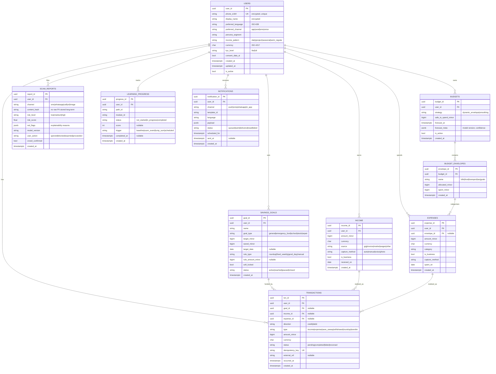

# 06 — Database Design

Polyglot persistence (per [ADR-0003](adr/0003-polyglot-persistence.md)):

- **Azure SQL / PostgreSQL** (relational, ACID) — core financial entities: Users, Income, Expenses, Budgets, SavingsGoals, Transactions, Notifications.
- **Cosmos DB** (document) — flexible/high-volume: ScamReports, LearningProgress content state, audit events.
- **Redis** — sessions, safe-to-spend cache, rate limits.
- **Blob/ADLS** — audio lessons, screenshots, model artifacts, analytics lake.

All monetary values stored in **minor units (integer cents)** with an explicit `currency` (ISO-4217) to avoid floating-point errors. All timestamps are `TIMESTAMPTZ` (UTC). All PII columns are encrypted (see [Security](09-security-architecture.md)).

> **Implementation note:** the `currency` column is specified here as `CHAR(3)` (fixed ISO-4217 code). The reference backend ([`/backend`](../backend)) implements it as `VARCHAR(3)` to avoid CHAR space-padding and keep JPA mapping simple; both hold the same 3-letter code.

---

## Entity Relationship Diagram

---

## Table specifications (relational core)

Below, **PK** = primary key, **FK** = foreign key, **UK** = unique. Index names follow `ix_<table>_<cols>`.

### users
| Column | Type | Constraints |
|---|---|---|
| user_id | UUID | **PK**, default gen_random_uuid() |
| phone_e164 | VARCHAR(20) enc | **UK**, NOT NULL |
| display_name | VARCHAR(120) enc | NULL |
| preferred_language | CHAR(2–5) | NOT NULL default 'en' |
| preferred_channel | VARCHAR(10) | NOT NULL default 'app' |
| persona_segment | VARCHAR(30) | NULL |
| income_pattern | VARCHAR(20) | NULL |
| currency | CHAR(3) | NOT NULL |
| kyc_level | VARCHAR(10) | NOT NULL default 'lite' |
| consent_data_ai | BOOLEAN | NOT NULL default false |
| is_active | BOOLEAN | NOT NULL default true |
| created_at / updated_at | TIMESTAMPTZ | NOT NULL |

**Indexes:** `ix_users_phone (phone_e164)` UNIQUE · `ix_users_segment (persona_segment)` · `ix_users_active (is_active)`.

### income
| Column | Type | Constraints |
|---|---|---|
| income_id | UUID | **PK** |
| user_id | UUID | **FK → users(user_id)** ON DELETE CASCADE, NOT NULL |
| amount_minor | BIGINT | NOT NULL, CHECK (amount_minor >= 0) |
| currency | CHAR(3) | NOT NULL |
| source | VARCHAR(20) | NOT NULL |
| capture_method | VARCHAR(10) | NOT NULL |
| is_business | BOOLEAN | NOT NULL default false |
| received_on | DATE | NOT NULL |
| created_at | TIMESTAMPTZ | NOT NULL |

**Indexes:** `ix_income_user_date (user_id, received_on DESC)` · `ix_income_user_business (user_id, is_business)`.

### expenses
| Column | Type | Constraints |
|---|---|---|
| expense_id | UUID | **PK** |
| user_id | UUID | **FK → users** CASCADE, NOT NULL |
| envelope_id | UUID | **FK → budget_envelopes** SET NULL, NULL |
| amount_minor | BIGINT | NOT NULL, CHECK (>0) |
| currency | CHAR(3) | NOT NULL |
| category | VARCHAR(40) | NOT NULL |
| is_business | BOOLEAN | NOT NULL default false |
| capture_method | VARCHAR(10) | NOT NULL |
| spent_on | DATE | NOT NULL |
| created_at | TIMESTAMPTZ | NOT NULL |

**Indexes:** `ix_expenses_user_date (user_id, spent_on DESC)` · `ix_expenses_envelope (envelope_id)` · `ix_expenses_user_cat (user_id, category)`.

### budgets / budget_envelopes
- **budgets.budget_id** PK; **user_id** FK → users CASCADE. `ix_budgets_user_active (user_id, is_active)`.
- **budget_envelopes.envelope_id** PK; **budget_id** FK → budgets CASCADE. `ix_envelopes_budget (budget_id)`.
- CHECK `spent_minor >= 0`, `allocated_minor >= 0`.

### savings_goals
| Column | Type | Constraints |
|---|---|---|
| goal_id | UUID | **PK** |
| user_id | UUID | **FK → users** CASCADE, NOT NULL |
| target_minor | BIGINT | NOT NULL, CHECK (>0) |
| saved_minor | BIGINT | NOT NULL default 0, CHECK (>=0) |
| rule_type | VARCHAR(15) | NOT NULL |
| status | VARCHAR(10) | NOT NULL default 'active' |
| ... | | |

**Indexes:** `ix_goals_user_status (user_id, status)` · partial `ix_goals_emergency (user_id) WHERE goal_type='emergency_fund'`.

### transactions
The financial ledger. Append-only; corrections via reversing entries.

| Column | Type | Constraints |
|---|---|---|
| txn_id | UUID | **PK** |
| user_id | UUID | **FK → users** RESTRICT, NOT NULL |
| goal_id | UUID | **FK → savings_goals** SET NULL, NULL |
| income_id | UUID | **FK → income** SET NULL, NULL |
| expense_id | UUID | **FK → expenses** SET NULL, NULL |
| direction | VARCHAR(6) | NOT NULL CHECK IN ('credit','debit') |
| type | VARCHAR(15) | NOT NULL |
| amount_minor | BIGINT | NOT NULL CHECK (>0) |
| status | VARCHAR(10) | NOT NULL |
| idempotency_key | VARCHAR(80) | **UK**, NOT NULL |
| occurred_at | TIMESTAMPTZ | NOT NULL |

**Indexes:** `ix_txn_user_time (user_id, occurred_at DESC)` · `ix_txn_goal (goal_id)` · `ix_txn_status (status)` · `ux_txn_idem (idempotency_key)` UNIQUE. Consider monthly **partitioning on occurred_at** at scale.

### notifications
- **notification_id** PK; **user_id** FK → users CASCADE.
- **Indexes:** `ix_notif_user_status (user_id, status)` · `ix_notif_scheduled (scheduled_for) WHERE status='queued'`.

---

## Document stores (Cosmos DB)

### scam_reports (partition key: `/userId`)
Stores verdicts and explainability; **raw message content is not retained** beyond processing — only a salted hash + extracted features — minimising PII and breach impact. Crowd-confirmed reports feed model retraining.

### learning_progress (partition key: `/userId`)
Tracks path/module state; content itself lives in a `content` container keyed by `/pathId` with localised variants.

### audit_events (partition key: `/userId`, TTL per retention policy)
Immutable security/audit trail (see [Security §Audit](09-security-architecture.md)) — append-only, write-once.

---

## Data governance

- **PII minimisation** — store the least needed; hash raw scam content.
- **Encryption** — TDE at rest + column-level encryption for PII; keys in Key Vault/HSM.
- **Retention** — financial records retained per regulation; scam raw content ephemeral; audit per ISO 27001 policy.
- **Right to erasure** — `user_id` cascade + crypto-shredding of PII keys; ledger anonymised (not deleted) for financial integrity.
- **Tenancy/residency** — data stored in-region to meet local data-residency rules.

---

**Related:** [API Design](07-api-design.md) · [Security Architecture](09-security-architecture.md) · [ADR-0003](adr/0003-polyglot-persistence.md)
