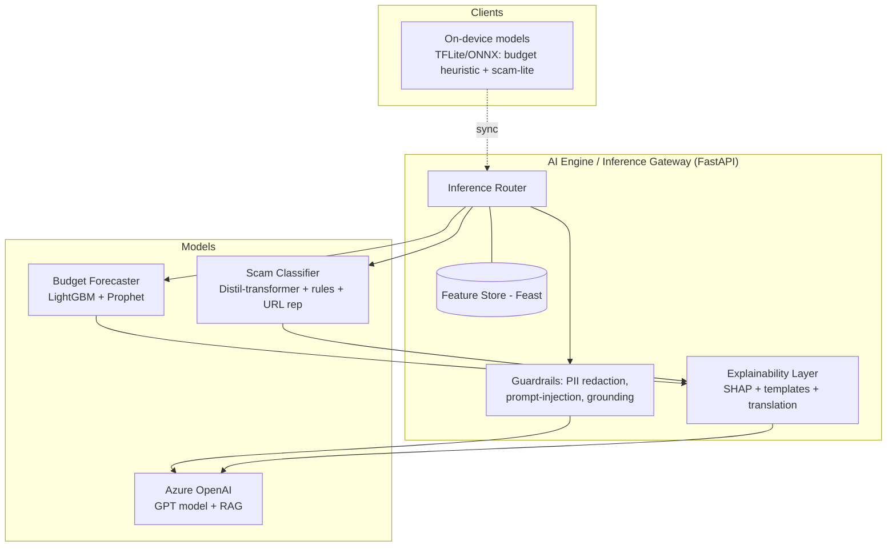
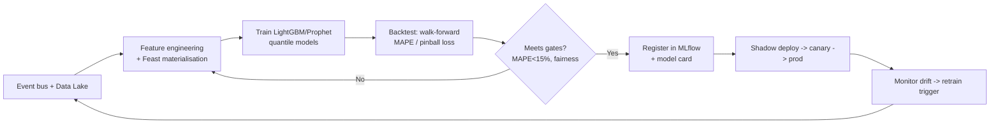

# 08 — AI Module Design

Three AI capabilities, each specified with Inputs · Outputs · Models · Training Pipeline · Explainability. A shared **AI Engine / Inference Gateway** fronts all models, enforces guardrails (PII redaction, prompt-injection defence, grounding), and provides the explainability layer. On-device variants enable offline use.

Design tenets: **explainable by default**, **frugal** (small models + caching to hit cost targets), **fair** (bias monitoring across language/segment), **safe** (never gives regulated financial *advice* — gives guidance with disclaimers and human-handoff for edge cases).



---

## 1. Budget Recommendation Engine

Turns irregular income/spend into dynamic envelopes, a daily **safe-to-spend** figure, and lean-period forecasts.

### Inputs
- Historical income events (amount, source, date), rolling volatility, seasonality signals.
- Recurring/known upcoming expenses (bills, due dates), discretionary spend history.
- Active goals + rules, emergency-fund target, user income-pattern class.
- Online features from Feast (e.g., `income_7d`, `income_volatility_8w`, `days_to_next_bill`).

### Outputs
- `safeToSpendTodayMinor`, envelope allocations, 14-day income/expense forecast, lean-period windows, **confidence** score, and structured reasons for the explainability layer.

### Models
- **Income/expense forecasting:** gradient-boosted trees (LightGBM) for short-horizon point forecasts + **Prophet/ETS** for seasonality (seasonal workers). Quantile regression for confidence bands.
- **Allocation policy:** constrained optimisation (cover bills → emergency buffer → goals → discretionary) rather than a black-box — keeps it auditable and safe.
- **Offline fallback:** lightweight heuristic (trailing median income − committed outflows) shipped on-device.

### Training pipeline

- Retrain cadence: weekly + drift-triggered. Metrics: MAPE, pinball loss, allocation-safety (never recommends overspend), budget adherence uplift (online A/B).

### Explainability
- SHAP feature importances mapped to human templates ("income 15% below 8-week average"). LLM renders reasons in the user's language. Counterfactuals in Phase 2 ("save R10 less → +R70 safe-to-spend").

---

## 2. Financial Education (Literacy Coach)

Personalises a learning path and generates/localises bite-size lessons grounded in the user's real data and a vetted curriculum.

### Inputs
- Baseline assessment, behaviour signals (budget adherence, savings streak, scam events), goals, language, literacy level, life-event triggers from the bus.

### Outputs
- Ordered personalised path, 2–3 min lesson scripts (audio-first), end-of-lesson action prompt, progress/mastery estimate.

### Models
- **Recommender:** contextual bandit / sequence model selecting the next-best module to maximise completion + behaviour change (reward = action taken + mastery gain).
- **Content generation:** Azure OpenAI with **RAG** over a curated, expert-reviewed financial-education corpus (grounding prevents hallucinated advice). Text-to-speech for audio; translation engine for localisation.
- **Mastery:** Bayesian Knowledge Tracing over assessment responses.

### Training pipeline
- Curriculum curated & reviewed by financial-education experts → embedded into a vector store (RAG ground truth). Bandit learns online from engagement; offline evaluation via counterfactual estimators before promotion. All generated content passes a safety/grounding check and (for new templates) human review.

### Explainability
- "Recommended because you just encountered a scam / received a lump sum." Mastery shown as a simple progress path; citations back to curriculum sources.

---

## 3. Scam Detection Engine

Classifies messages/URLs/images as scam risk with explainable red flags; on-device fallback for offline protection.

### Inputs
- Raw text / URL / image (OCR'd), language, channel, sender metadata, URL reputation/threat-intel lookups, crowd-report signals, user context (optional).

### Outputs
- `riskLevel` (low/med/high), `riskScore` (0–1), ranked **redFlags** with plain-language explanations, recommended actions. Verdict + features persisted (raw content hashed, not stored — see [DB §scam_reports](06-database-design.md)).

### Models
- **Text classifier:** distilled multilingual transformer fine-tuned on scam corpora (phishing, advance-fee, fake-loan, pyramid), augmented with **rule features** (urgency, credential request, payment-up-front, impersonation, lookalike domains).
- **URL analysis:** reputation feeds + lexical/lookalike-domain features.
- **Image path:** Azure AI Vision OCR → text classifier.
- **On-device scam-lite:** quantised small model + keyword/rule pack (updated via sync) for offline verdicts.
- **Ensemble:** calibrated score fusion; threshold tuned for **high recall** (missing a scam is worse than a false alarm) while keeping precision ≥ 90%.

### Training pipeline
```mermaid
flowchart LR
    A[Scam corpora + telco feeds\n+ crowd reports (crowd_confirmed)] --> B[Label + de-dup + PII strip]
    B --> C[Fine-tune transformer\n+ engineer rule features]
    C --> D[Eval: precision/recall/F1\nper language + segment fairness]
    D --> E{Recall>=85 & Prec>=90?}
    E -- No --> B
    E -- Yes --> F[MLflow register + model card]
    F --> G[Canary + shadow]
    G --> H[Feedback loop:\nuser_action + crowd confirm]
    H --> A
```
- Continuous learning from `scam_reports.user_action` and `crowd_confirmed`. Adversarial/robustness testing (obfuscated text, homoglyphs). Fairness checks so low-resource languages aren't under-protected.

### Explainability
- Red flags are first-class model outputs (rule hits + attention/attribution), each with a template explanation. This is the user-facing trust mechanism — the app shows *why*, not just "blocked."

---

## Shared guardrails & governance

| Concern | Control |
|---|---|
| PII leakage to LLM | Redact/tokenise PII before prompts; private Azure OpenAI endpoint; no training on user prompts |
| Prompt injection (scam content → LLM) | Treat all user/scanned content as untrusted data; sandboxed prompts; output grounding checks |
| Hallucinated financial advice | RAG grounding + disclaimers; guidance-not-advice policy; refuse/handoff on regulated topics |
| Bias / fairness | Per-language & per-segment metric monitoring; fairness gates in training |
| Drift | Data & concept drift monitors → retrain triggers |
| Cost | Small models + response caching + batching; LLM only where it adds value (explanation/translation) |
| Auditability | Every inference logs model version, inputs' hash, outputs, latency (to audit store) |
| Human oversight | Low-confidence or high-impact cases routed to human review (Phase 2 ops) |

## MLOps stack
- **Tracking/registry:** MLflow. **Features:** Feast. **Serving:** containerised on AKS GPU pool + Azure ML endpoints for heavy models. **Pipelines:** Azure ML Pipelines/GitHub Actions. **Monitoring:** Azure Monitor + Evidently (drift) + custom fairness dashboards. Each model ships a **model card** (intended use, data, metrics, limitations).

---

**Related:** [System Architecture](05-system-architecture.md) · [Cloud Architecture](11-cloud-architecture.md) · [Security](09-security-architecture.md)
