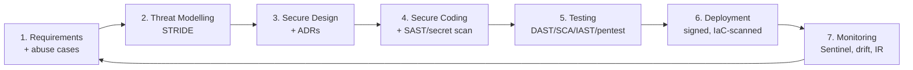

# 10 — SSDLC Framework

A Secure Software Development Lifecycle woven through every phase, with security as a shared responsibility rather than a gate at the end. Threat modelling uses **STRIDE**. The framework aligns with ISO 27001 secure-development controls and OWASP SAMM.

---

## 1. Requirements (security requirements & abuse cases)
- Derive security requirements from data classification (PII, financial, auth) and ASVS L2.
- Capture **abuse/misuse cases** alongside user stories ("As an attacker I want to drain a user's savings goal").
- Define privacy requirements (consent, residency, retention) and a **DPIA** for AI features.
- **Gate:** every epic has documented security & privacy acceptance criteria.

## 2. Threat Modelling — STRIDE
Performed per service at design time and on significant change. Data-flow diagrams feed STRIDE analysis.

### Example STRIDE model — Savings sweep flow
| Threat | Example | Mitigation |
|---|---|---|
| **S**poofing | Attacker impersonates user to trigger withdrawal | OIDC + MFA step-up, device binding, mTLS between services |
| **T**ampering | Modify sweep amount in transit / at rest | TLS/mTLS, signed requests, DB integrity constraints, idempotency keys |
| **R**epudiation | User/attacker denies a transaction | Immutable audit trail, hash-chaining, signed events |
| **I**nformation disclosure | Leak of balances/PII | Column encryption, least-privilege, PII minimisation, log scrubbing |
| **D**enial of service | Flood sweep/scan endpoints | Rate limiting, quotas, autoscale, circuit breakers |
| **E**levation of privilege | User accesses another's goal (IDOR) | Ownership checks, OPA policies, deny-by-default |

### Example STRIDE — Scam Shield / AI path
| Threat | Example | Mitigation |
|---|---|---|
| Spoofing | Malicious content poses as system prompt (prompt injection) | Treat scanned content as untrusted data, sandboxed prompts, output grounding |
| Tampering | Model poisoning via crowd reports | Report validation, crowd-confirm thresholds, anomaly checks before training |
| Info disclosure | PII sent to LLM | Redaction/tokenisation pre-prompt, private endpoint, no training on prompts |
| DoS | Expensive inference abuse | Quotas, caching, small-model routing, GPU pool limits |

**Gate:** threat model reviewed and residual risks accepted/signed before build.

## 3. Secure Design
- Apply secure design patterns: deny-by-default, fail-safe, defence-in-depth, complete mediation.
- Record significant decisions as **ADRs** (see [/adr](adr/)).
- Security design review for auth, crypto, data flows, and AI guardrails.
- Privacy-by-design: minimise, pseudonymise, define retention.

## 4. Secure Coding
- Enforced coding standards (OWASP secure-coding) + language guides.
- **Pre-commit & CI:** secret scanning (gitleaks), SAST (CodeQL/SonarQube), lint, dependency pinning.
- Mandatory peer review with a **security checklist**; no self-merge to protected branches.
- Parameterised queries, input validation, output encoding, safe deserialization by default.
- Developer security training & secure-coding champions per squad.

## 5. Testing
| Test type | Tool/approach | When |
|---|---|---|
| SAST | CodeQL / SonarQube | Every PR |
| SCA + SBOM | Snyk/Dependabot + Syft | Every PR + daily |
| Secret scan | gitleaks | Every PR |
| DAST | OWASP ZAP | Nightly / pre-release against staging |
| IAST | Runtime instrumentation | Staging |
| Container scan | Trivy/Defender | Build & registry |
| IaC scan | Checkov/tfsec | Every PR |
| Unit/integration security tests | authZ/ownership, input-fuzz | Every PR |
| Penetration test | External + internal | Pre-launch & annually |
| AI red-teaming | Prompt-injection, jailbreak, bias | Per model release |

**Gates:** no Critical/High vulns unresolved; SAST/DAST/SCA must pass; security tests green.

## 6. Deployment
- **Signed, verifiable supply chain:** signed commits, Cosign-signed images, SLSA-aligned provenance, admission control rejects unsigned images.
- IaC (Bicep/Terraform) peer-reviewed + policy-scanned; **Azure Policy** enforces guardrails (no public DB, encryption required).
- Progressive delivery: canary/blue-green with automated rollback on SLO/security regression.
- Secrets injected at runtime via Key Vault + Managed Identity.
- Change management with approvals for production (ISO 27001 A.8.32).

## 7. Monitoring & Response
- Continuous: Sentinel SIEM/SOAR, Defender for Cloud, Azure Monitor, drift & fairness monitors.
- **Incident response:** documented IR runbooks, severity matrix, on-call rotation, SOAR auto-containment, post-incident reviews (blameless), regulator/user notification process.
- Vulnerability management: patch SLAs (Critical 48h, High 7d), recurring scans, bug-bounty (Phase 2).
- Feedback loop: incidents & findings update threat models and requirements (closing the lifecycle).

---

## RACI (security activities)
| Activity | Dev | Security | Ops/SRE | Product |
|---|---|---|---|---|
| Abuse cases | C | A/R | I | R |
| Threat model | R | A | C | C |
| Secure coding | A/R | C | I | I |
| Security testing | R | A | C | I |
| Deploy guardrails | C | A | R | I |
| Incident response | C | A/R | R | I |

A=Accountable, R=Responsible, C=Consulted, I=Informed.

## Compliance evidence produced
Threat models, ADRs, scan reports, pentest reports, SBOMs, audit logs, DPIAs, model cards — all retained as ISO 27001 / audit evidence.

---

**Related:** [Security Architecture](09-security-architecture.md) · [DevOps Pipeline](13-devops-pipeline.md) · [ADRs](adr/)
