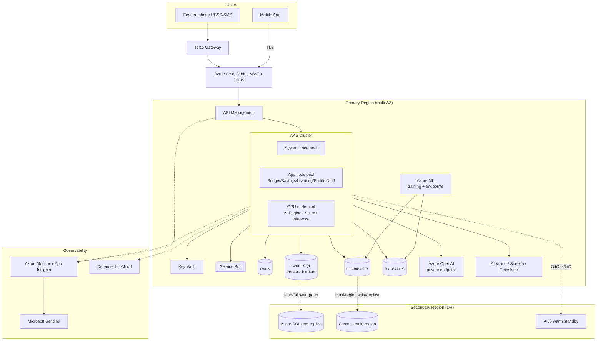

# 11 — Cloud Architecture (Azure)

Azure-preferred, cloud-native deployment. Compute runs on **AKS** (microservices + AI serving) with **App Service** for lighter web/API workloads and simpler services. Multi-zone for HA, with a secondary region for DR. Everything is private-by-default (private endpoints, no public data plane).

## Azure service mapping

| Concern | Azure service | Notes |
|---|---|---|
| Edge / CDN / WAF | **Azure Front Door + WAF** | Global entry, TLS, DDoS, WAF rules |
| API management | **Azure API Management** | AuthN/Z, rate limit, routing, developer portal |
| Container orchestration | **Azure Kubernetes Service (AKS)** | Microservices, AI serving, GPU node pool |
| Lighter services / BFF | **Azure App Service** | USSD/SMS service, admin, low-complexity APIs |
| Relational data | **Azure SQL** (or Flexible PostgreSQL) | TDE, geo-replication, auto-failover group |
| Document data | **Azure Cosmos DB** | Scam reports, learning content, audit |
| Cache | **Azure Cache for Redis** | Sessions, safe-to-spend, rate limits |
| Object storage / lake | **Azure Blob + ADLS Gen2** | Audio, screenshots, models, analytics lake |
| Messaging | **Azure Service Bus** | Life-events bus; **Event Grid** for system events |
| LLM / GenAI | **Azure OpenAI** | Private endpoint; coaching, explanation, translation |
| Vision / OCR | **Azure AI Vision** | Scam screenshot OCR |
| Speech | **Azure AI Speech** | STT/TTS for voice assistant, multilingual |
| Translation | **Azure AI Translator** | Multilingual engine |
| ML platform | **Azure Machine Learning** | Training pipelines, model endpoints, registry |
| Secrets / keys | **Azure Key Vault** (HSM) | Keys, secrets, certs, BYOK |
| Identity | **Microsoft Entra ID** + Managed Identities | Workload identity, no secrets in code |
| Monitoring | **Azure Monitor + App Insights** | Metrics, traces, logs, dashboards |
| SIEM / SOAR | **Microsoft Sentinel** | Threat detection, playbooks |
| Posture / workload protection | **Microsoft Defender for Cloud** | CSPM/CWPP, image scanning |
| IaC | **Bicep / Terraform** + **Azure Policy** | Guardrails, drift detection |
| Registry | **Azure Container Registry** | Signed images, vuln scanning |

---

## Deployment architecture

---

## Networking & isolation
- **Hub-spoke VNet**; AKS and data services on private subnets with **Private Endpoints** (no public SQL/Cosmos/Blob/OpenAI).
- **NSGs + Azure Firewall** for egress allow-listing (SSRF/exfiltration control).
- Service mesh (Istio/Linkerd) for **mTLS** + traffic policy inside AKS.
- API Management is the only ingress to services; Front Door the only ingress to APIM.

## Scalability & resilience
- **HPA/KEDA** autoscaling (CPU, queue depth, custom metrics); GPU pool scales on inference queue.
- Multi-AZ node pools; PodDisruptionBudgets; zone-redundant data tier.
- **DR:** SQL auto-failover group + Cosmos multi-region; GitOps (Flux/Argo) rebuilds AKS in DR region. Targets: **RPO ≤ 5 min, RTO ≤ 30 min**.
- Backups: automated DB backups (PITR), geo-redundant storage, tested restore runbooks.

## Cost optimisation (hits <$0.08/user/month target)
- Spot/low-priority nodes for batch training & non-critical jobs.
- Autoscale to zero for idle GPU; cache LLM responses; route to small models first.
- Reserved instances / savings plans for steady baseline; lifecycle tiering of blob (hot→cool→archive).
- Low-data client design reduces egress and request volume.

## Environments & governance
- `dev` → `staging` → `prod` subscriptions, isolated, least-privilege.
- **Azure Policy** enforces: encryption on, no public endpoints, allowed regions (residency), required tags, approved SKUs.
- All infra via **IaC (Bicep/Terraform)** in Git; changes peer-reviewed + policy-scanned (see [DevOps](13-devops-pipeline.md)).

## Data residency
Regional deployments keep user data in-country to satisfy local regulation; a multi-region topology lets MoneyMate expand market-by-market without co-mingling data.

---

**Related:** [System Architecture](05-system-architecture.md) · [Security](09-security-architecture.md) · [DevOps Pipeline](13-devops-pipeline.md) · [ADR-0001](adr/0001-cloud-provider-azure.md)
