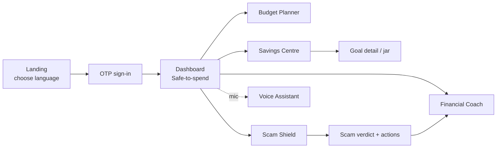

# 12 — UI/UX Design

The UX is built for the hardest cases first: low literacy, low vision, low connectivity, low data, and the user's own language. If it works for Maria and Sipho, it works for everyone. Design philosophy: **calm, reassuring, plain, and forgiving** — never a dense "banking dashboard."

## Design principles
1. **Plain over precise** — "You can safely spend R120 today," not "Disposable income: R120.00."
2. **Show, speak, and read** — every key action is reachable by tap, **voice**, and large iconography; text is backed by audio.
3. **One decision per screen** — reduce cognitive load; progressive disclosure.
4. **Forgiving** — undo everywhere; confirm destructive/money-moving actions; no dead ends.
5. **Reassuring** — positive, non-judgemental tone; celebrate small wins.
6. **Frugal** — low-data by default; works offline; graceful skeletons, not spinners.

---

## Design system

### Colour palette
Chosen for trust, warmth, accessibility, and meaning. All pairings meet WCAG AA contrast (≥4.5:1 text).

| Token | Hex | Use |
|---|---|---|
| `--mm-primary` | `#0B6E4F` | Primary (deep green = growth, trust, money) |
| `--mm-primary-dark` | `#07513A` | Pressed/headers |
| `--mm-accent` | `#F4A700` | Encouragement, highlights (warm gold) |
| `--mm-safe` | `#2E9E5B` | Positive / safe-to-spend |
| `--mm-warn` | `#E8A33D` | Caution (scam medium) |
| `--mm-danger` | `#C8402B` | High-risk scam / overspend |
| `--mm-ink` | `#1A2B26` | Primary text |
| `--mm-muted` | `#5B6B65` | Secondary text |
| `--mm-bg` | `#F7FAF8` | App background |
| `--mm-surface` | `#FFFFFF` | Cards |
| `--mm-line` | `#E1E8E4` | Borders |

Semantic colour is **never the only signal** (colour-blind safe): risk states pair colour + icon + label.

### Typography
- **Family:** Inter / Noto Sans (Noto for broad multilingual + script coverage).
- **Scale (mobile):** Display 28/34 · H1 24/30 · H2 20/26 · Body-L 18/26 (default — larger than typical for low-vision) · Body 16/24 · Caption 14/20.
- Minimum body **18px**; dynamic type honoured; never below 14px.
- Max line length constrained; generous line-height for readability.

### Spacing, shape, motion
- 8pt spacing grid; 12px card radius; large 56px tap targets (≥48px min).
- Subtle motion (≤200ms), reduced-motion respected; no essential info conveyed by motion alone.

---

## Component library (atoms → organisms)

| Component | Notes |
|---|---|
| Button (primary/secondary/ghost/danger) | 56px tall, icon + label, voice-triggerable |
| MoneyAmount | Formats minor units + currency, large, screen-reader labelled |
| SafeToSpendCard | Hero number + plain explanation + "why?" link |
| EnvelopePill | Category, allocated vs spent, progress bar |
| GoalJar | Animated fill, % + streak badge |
| RiskBadge | low/med/high with icon+colour+label |
| ScamVerdictCard | Verdict + red-flag list + action buttons |
| LessonCard | Title, duration, audio play, offline badge |
| VoiceButton | Persistent mic FAB; press-to-talk, waveform |
| LanguageSwitcher | Flag-free list of language names in-script |
| OfflineBanner | "You're offline — changes will sync" |
| Toast/Undo | Confirmations with undo |
| EmptyState | Friendly illustration + one action |
| BottomNav | 4 items max, icon+label |

All components: keyboard navigable, ≥48px targets, ARIA/semantic labels, RTL-ready, theming via tokens.

---

## Accessibility standards (WCAG 2.2 AA target)
- **Perceivable:** AA contrast; text resize to 200%; audio alternatives for text; captions for any video; icon+label+colour for state.
- **Operable:** large targets (2.5.5), full voice control, no time-critical traps, reduced motion.
- **Understandable:** plain language (aim ~grade-6 readability), consistent navigation, clear errors with guidance, confirmation for money actions.
- **Robust:** semantic components, screen-reader tested (TalkBack), proper roles/labels.
- **Beyond WCAG:** audio-first flows and voice input for non-readers; feature-phone (USSD) parity for the digitally excluded.

> Full WCAG conformance requires manual testing with assistive tech and expert review; this spec sets the design targets and automated checks, not a conformance claim.

---

## Key screens

### Landing / Onboarding
Warm, trust-building. Language picked **first** (in-script). Phone + OTP (no email). 3 plain promises: *Plan your money · Save a little · Stay safe from scams.* Voice narration available. Minimal fields.

### Dashboard (home)
Hero **SafeToSpendCard** ("You can safely spend R120 today" + "why?"). Below: top 2–3 envelopes, nearest goal jar, a gentle tip, and the persistent **VoiceButton**. One glance, one feeling: *I'm okay today.*

### Budget Planner
Envelopes as pills with progress; add income/expense via tap/voice/photo; "safe-to-spend" with expandable explanation (the XAI reasons). Lean-period warning banner when forecast predicts a shortfall.

### Savings Centre
Goal jars (animated fill, streaks). Create goal by voice. Choose savings rule with plain descriptions. Emergency fund shown as "weeks covered." Withdrawal path has gentle friction + undo.

### Scam Shield
Big, reassuring "Check a message" action (paste / forward / screenshot). Verdict screen: RiskBadge + plain red-flag list ("Asks for your PIN — banks never do this") + one-tap actions (block, report, warn). Ends with a tiny matching lesson. Judgement-free copy.

### Financial Coach
Personal path as a simple vertical journey; LessonCards (2–3 min, audio play, offline badge). Each lesson ends with a one-tap real action. Progress + streak celebrated.

---

## Visual mock — Dashboard


---

## Low-fidelity screen flow



## USSD parity (feature phones)
```
*134# MoneyWise
1. Save money
2. My balance
3. My goals
4. Check a scam (SMS)
5. Money tip
0. Language
```
Every MVP money action has a USSD/SMS equivalent — inclusion is not optional.

---

**Related:** [User Journeys](03-user-journeys.md) · [Feature List](04-feature-list.md) · [API Design](07-api-design.md)
