# 13 — DevOps Pipeline

CI/CD built on **GitHub Actions** → **Docker** images in **Azure Container Registry** → **Kubernetes (AKS)** via GitOps. Security scanning is built into every stage (shift-left), matching the [SSDLC](10-ssdlc-framework.md). Trunk-based development with short-lived feature branches and protected `main`.

## Pipeline overview

```mermaid
flowchart LR
    DEV[Commit / PR\nsigned commits] --> CI
    subgraph CI["CI (GitHub Actions)"]
        B[Build + unit tests]
        L[Lint + format]
        SAST[SAST CodeQL]
        SEC[Secret scan gitleaks]
        SCA[SCA Snyk + SBOM]
        IMG[Docker build + Trivy scan]
        SIGN[Cosign sign image]
    end
    DEV --> B --> L --> SAST --> SEC --> SCA --> IMG --> SIGN
    SIGN --> ACR[(Azure Container Registry)]
    ACR --> CD
    subgraph CD["CD (GitOps - Argo/Flux)"]
        STG[Deploy to Staging]
        DAST[DAST ZAP + integration tests]
        CAN[Canary to Prod]
        PROM[Promote / Rollback]
    end
    ACR --> STG --> DAST --> CAN --> PROM
    PROM --> MON[Monitoring\nAzure Monitor + Sentinel]
    MON -. SLO/security regression .-> PROM
```



---

## Stages

### Build
- Multi-stage **Dockerfiles** (small, non-root, distroless/alpine base), reproducible builds, pinned base images.
- Per-service build matrix; shared caching for speed.
- Unit tests must pass; coverage gate (e.g., ≥80% on changed code).

### Test
| Level | What | Tooling |
|---|---|---|
| Unit | Logic, domain rules, authZ/ownership | JUnit / pytest |
| Integration | Service + DB + bus (Testcontainers) | Testcontainers |
| Contract | API provider/consumer | Pact + OpenAPI validation |
| E2E | Critical journeys on staging | Playwright / Appium |
| Performance | Load/soak on key endpoints | k6 |
| Accessibility | Automated a11y checks | axe |

### Security scan (gates — no Critical/High passes through)
- **SAST** CodeQL/SonarQube · **Secrets** gitleaks · **SCA + SBOM** Snyk + Syft · **Container** Trivy/Defender · **IaC** Checkov/tfsec · **DAST** OWASP ZAP (staging) · **AI red-team** suite per model release.
- **Image signing** with Cosign; AKS **admission controller** rejects unsigned/unscanned images (supply-chain integrity).

### Deploy
- **GitOps** (Argo CD / Flux): desired state in Git, auto-reconciled to AKS; PR-based promotion between envs.
- **Progressive delivery:** canary (5%→25%→100%) or blue-green via Argo Rollouts; automated rollback on SLO/error-budget/security-signal breach.
- **IaC** (Bicep/Terraform) for all infra; `terraform plan` + policy scan on PR; apply on merge with approval for prod.
- Secrets via **Key Vault + Managed Identity / CSI driver** — never in images or Git.
- DB migrations: versioned (Flyway/Liquibase), expand-contract pattern for zero-downtime.

### Monitoring (close the loop)
- **Azure Monitor + App Insights:** golden signals (latency, traffic, errors, saturation), distributed tracing, per-service dashboards.
- **SLOs & error budgets** drive release pace; alerting via on-call (PagerDuty/Teams).
- **Microsoft Sentinel** security monitoring + SOAR auto-response.
- **ML monitoring:** drift/fairness (Evidently) → retrain triggers.
- Deployment markers correlate releases with metric changes; auto-rollback hooks.

---

## Environments & branching
- **Branching:** trunk-based; short-lived branches; PR required; ≥1 review + green checks; protected `main`; signed commits.
- **Environments:** `dev` (ephemeral PR previews) → `staging` (prod-like, DAST/E2E) → `prod` (canary). Each isolated Azure subscription.
- **Release cadence:** continuous to staging; gated canary to prod multiple times/week.

## Kubernetes specifics
- Namespaces per service domain; **HPA/KEDA** autoscaling; PodDisruptionBudgets; resource requests/limits enforced.
- **NetworkPolicies** (deny-by-default), service mesh mTLS, OPA Gatekeeper policies (no privileged pods, required labels, signed images).
- Health probes (liveness/readiness/startup); graceful shutdown; rolling updates.
- GPU node pool (taints/tolerations) for AI workloads; scale-to-zero when idle.

## Sample GitHub Actions workflow (abridged)
```yaml
name: ci-cd
on: { pull_request: {}, push: { branches: [main] } }
jobs:
  build-test-scan:
    runs-on: ubuntu-latest
    permissions: { contents: read, id-token: write, security-events: write }
    steps:
      - uses: actions/checkout@v4
      - name: Unit tests
        run: ./gradlew test        # or: pytest
      - name: SAST (CodeQL)
        uses: github/codeql-action/analyze@v3
      - name: Secret scan
        uses: gitleaks/gitleaks-action@v2
      - name: SCA + SBOM
        run: snyk test && syft dir:. -o spdx-json > sbom.json
      - name: Build image
        run: docker build -t $ACR/budget:${{ github.sha }} .
      - name: Scan image
        run: trivy image --exit-code 1 --severity CRITICAL,HIGH $ACR/budget:${{ github.sha }}
      - name: Sign image
        run: cosign sign --yes $ACR/budget:${{ github.sha }}
      - name: Push
        run: docker push $ACR/budget:${{ github.sha }}
  deploy-staging:
    needs: build-test-scan
    if: github.ref == 'refs/heads/main'
    runs-on: ubuntu-latest
    steps:
      - name: Update GitOps manifest
        run: ./scripts/bump-image.sh budget ${{ github.sha }}   # Argo reconciles
      - name: DAST (ZAP) on staging
        run: zap-baseline.py -t https://staging.moneywise.app
```

---

**Related:** [Cloud Architecture](11-cloud-architecture.md) · [SSDLC](10-ssdlc-framework.md) · [Security](09-security-architecture.md)
