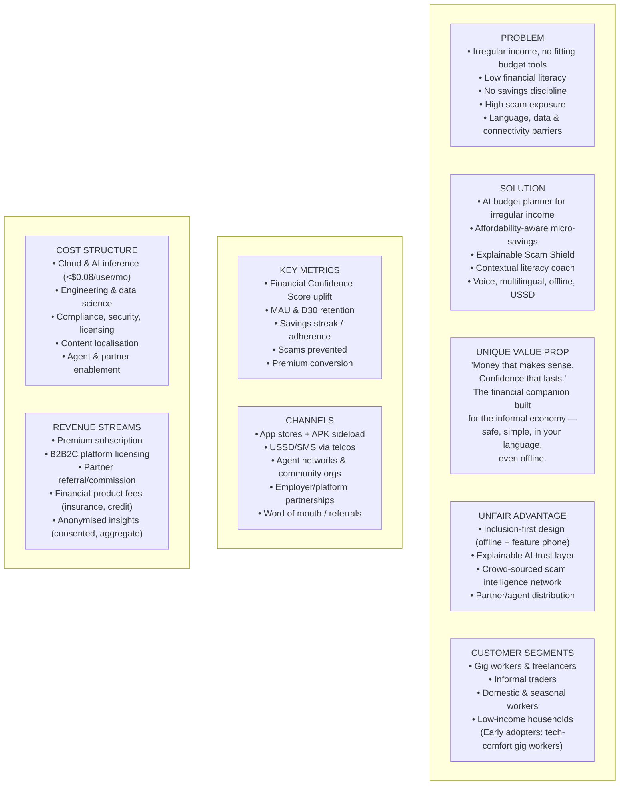
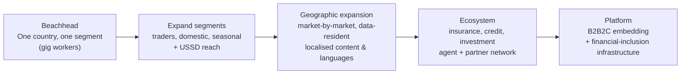

# 14 — Business Model

MoneyMate must be commercially sustainable without extracting from the vulnerable users it serves. The model is **freemium + B2B2C + ecosystem fees** — the core safety and inclusion features are always free; revenue comes from premium power-users, partners, and value-added financial products, never from exploiting low-income users.

## Lean Canvas

---

## Revenue streams

| Stream | Description | Phase |
|---|---|---|
| **Freemium → Premium** | Free core (budget, save, scam, learn). Premium (~$1–2/mo, locally priced): advanced forecasting, lump-sum smoothing, multi-account, tax tools, deeper analytics. | MVP→P2 |
| **B2B2C licensing** | Gig platforms, employers of informal/domestic workers, MFIs and co-ops embed MoneyMate for their workforce (per-seat/SaaS). Strong fit — platforms want financially stable workers. | P2 |
| **Partner commissions** | Referral/commission on **suitable** partner products (micro-insurance, fair credit, savings/investment) surfaced contextually and transparently. | P3 |
| **Financial-product fees** | Thin margin on facilitated products via licensed partners (not balance-sheet risk early). | P3 |
| **Aggregated insights** | Consented, anonymised, aggregated financial-inclusion insights for development orgs/regulators. Never individual data; opt-in only. | P3 |
| **Grants & impact capital** | Financial-inclusion grants/DFIs fund underserved reach (feature-phone, rural) during scale-up. | MVP→P2 |

**Ethical guardrails:** no predatory lending, no selling personal data, no dark patterns, transparent pricing, partner suitability checks. Revenue aligns with user wellbeing (we earn when users are financially healthier).

## Pricing philosophy
- Core safety/inclusion = **free forever**.
- Premium is value-add for users who can pay (freelancers like Carlos), **cross-subsidising** free users.
- Local, PPP-adjusted pricing; pay-with-airtime options.

---

## Scaling strategy

1. **Beachhead:** dominate one segment in one market (tech-comfortable gig workers = fastest adoption), prove FCS uplift + retention.
2. **Deepen:** add USSD/voice-heavy segments (traders, seasonal) to prove inclusion reach.
3. **Geographic:** replicate per-market with localisation and data residency; reuse platform, swap content/language/rails.
4. **Ecosystem:** add partner financial products once trust + data maturity support them.
5. **Platform:** license the engine (B2B2C) — become inclusion infrastructure.

**Growth loops:** referral incentives; Scam Shield "warn your contacts" (viral + protective); agent-assisted onboarding in low-trust communities; employer/platform distribution.

## Partnership strategy

| Partner type | Value to MoneyMate | Value to partner |
|---|---|---|
| **Telcos / MNOs** | USSD/SMS reach, airtime billing, distribution | Stickier subscribers, value-add service |
| **Mobile-money providers** | Transaction data (consented), rails | Engagement, financial health of users |
| **Gig/ride-hailing platforms** | Distribution to workers, payout data | Financially stable, retained workers |
| **MFIs / SACCOs / co-ops** | Trusted community distribution | Digital tools, better-performing members |
| **Insurers / lenders (vetted)** | Product supply for ecosystem | Qualified, screened customer access |
| **NGOs / dev orgs / DFIs** | Funding, reach, credibility | Measurable financial-inclusion impact |
| **Regulators** | Sandbox access, licensing path | Consumer protection, inclusion data |
| **Azure / cloud** | Infra credits, AI tooling, go-to-market | Flagship inclusion use-case |

Partnerships are the primary distribution engine — reaching the informal economy is a trust-and-access problem, best solved through organisations users already trust.

---

**Related:** [Product Vision](01-product-vision.md) · [Feature List](04-feature-list.md) · [Hackathon Demo](15-hackathon-demo.md)
