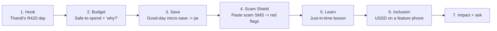

# 15 — Hackathon Demo Kit

Everything needed to win the room: a live demo script, the flow, judge talking points, and three timed pitches (3 / 5 / 10 min). The narrative hero is **Thandi** (gig driver) with cameos from **Grace** (feature-phone trader) and **Sipho** (USSD-only) to prove inclusion.

> **One-liner:** *MoneyMate is the AI financial confidence assistant for the informal economy — it budgets irregular income, builds savings that stick, teaches money skills, and shields people from scams, in their language, even offline.*

---

## Demo flow (the story)

## Demo script (≈4 min live walkthrough)

**[0:00] Hook.** "Meet Thandi. She drives for three apps. Yesterday she made R420 — but is that a good day or a bad day? She has no idea. 2 billion people live on income like this, and every finance app assumes a monthly salary." *(Show dashboard.)*

**[0:40] Budget.** "MoneyMate says: *you can safely spend R120 today*. Tap 'why?' — and here's the magic: it explains itself. Income's 15% below her 8-week average, R600 of bills are due, she's on track for her car-repair goal. Plain language, her language — Zulu." *(Tap the explanation.)*

**[1:30] Save.** "Today's a good day, so MoneyMate sweeps a small amount into her Car Repair jar — and skips it automatically on slow days. 4-week streak." *(Show jar fill + streak.)*

**[2:10] Scam Shield — the showstopper.** "Then this lands." *(Paste: 'You won R5000! Click to verify your bank PIN.')* "MoneyMate flags it HIGH risk and tells her exactly why: it creates urgency, it asks for a PIN — banks never do — and the link is hidden. One tap to block, report, and warn her contacts." *(Show red-flag verdict.)*

**[2:50] Learn.** "Right after, a 2-minute audio lesson on spotting that exact scam. Learning in the moment it matters."

**[3:20] Inclusion.** "Now watch this." *(Pick up a feature phone, dial `*134#`.)* "Grace, a market trader with no smartphone, does the same things over USSD. And it all works offline — no data needed. **That's** financial inclusion."

**[3:50] Close.** "MoneyMate: money that makes sense, confidence that lasts."

### Demo setup / fallback
- Pre-seeded demo account (Thandi) with realistic income history.
- Scripted scam SMS ready to paste. USSD simulator or real handset + telco sandbox.
- **Offline proof:** toggle airplane mode mid-demo to show budget + scam check still working.
- Fallback: recorded 90-sec screen capture if live network fails.

---

## Judge talking points

**Impact / inclusion**
- Built offline-first + feature-phone (USSD/SMS) first — reaches the 60%+ excluded by smartphone-only fintech.
- Multilingual, voice-first, audio lessons — serves low-literacy users others ignore.
- Actively *protects* vulnerable users from fraud, not just tracks spending.

**Technical depth**
- Cloud-native microservices on Azure, event-driven, offline sync, on-device models.
- Explainable AI (SHAP + LLM) — the "why?" is a product feature, building trust.
- Volatility-aware budgeting designed *for* irregular income, not retrofitted.

**Security & trust (fintech must-have)**
- Zero Trust, OWASP ASVS L2, ISO 27001-aligned, immutable audit, PII minimisation (scam content hashed, never stored).
- STRIDE threat modelling baked into the SSDLC.

**Business viability**
- Freemium + B2B2C + ethical partner ecosystem; cost-to-serve < $0.08/user/month; revenue aligned with user wellbeing.
- Clear scaling path and distribution via telcos, gig platforms, agents.

**Likely questions — crisp answers**
- *"How do you make money without exploiting poor users?"* Free core forever; premium power-users + B2B2C + vetted partners cross-subsidise.
- *"Why will the AI be trusted?"* Every recommendation is explained in plain language; we give guidance, not regulated advice, with human handoff.
- *"Offline AI — really?"* Lightweight on-device models for budgeting heuristics and a scam-lite classifier; full models sync when online.
- *"Regulation?"* MVP uses KYC-lite + partner rails to limit regulatory surface; scale KYC/AML with product phase, market by market.

---

## 3-minute pitch
"Two billion people earn irregular income — gig workers, traders, domestic and seasonal workers. Every finance app assumes a monthly salary, English, a smartphone, and data. They have none of those, and they're the most targeted by scams with the least to lose.

MoneyMate is the AI financial confidence assistant built for them. It turns unpredictable income into a simple 'safe-to-spend today,' and it *explains itself* in the user's own language. It saves automatically on good days and backs off on bad ones. Its Scam Shield spots fraud and shows people exactly why something's dangerous. And it teaches money skills in 2-minute lessons, right when they're needed.

Crucially, it works offline and on a basic feature phone over USSD — so it reaches the people smartphone-only fintech leaves behind. It's cloud-native on Azure, secure by design, and sustainable through freemium and partnerships — never by exploiting the users we serve. MoneyMate: money that makes sense, confidence that lasts."

## 5-minute pitch
Covers the 3-min pitch, plus:
- **Problem depth (1 min):** the compounding pains — irregular income breaks monthly budgeting; low literacy makes generic advice useless; no savings infrastructure; disproportionate scam exposure; language, data, and connectivity barriers.
- **Live demo (2 min):** dashboard "safe-to-spend" + explainability → good-day micro-save → Scam Shield verdict with red flags → USSD on a feature phone + offline toggle.
- **How it works (1 min):** Azure microservices, event-driven life-events bus, volatility-aware forecasting + explainable AI, on-device models for offline, Zero-Trust security.
- **Why we win + ask (1 min):** inclusion-first moat, trust via explainability, crowd scam-intelligence network; freemium + B2B2C model; ask for pilot partners (a telco + a gig platform) and inclusion funding.

## 10-minute pitch (structure)
1. **Open with Thandi (0:30)** — a day in her financial life; the emotional hook.
2. **Problem & market (1:30)** — size the informal economy; the compounding pains; why existing fintech fails them; scam vulnerability stat.
3. **Vision & solution (1:30)** — mission; the four pillars (simpler, safer, more useful, reachable); the signature features.
4. **Live demo (3:00)** — full flow: budget + explainability → affordability-aware saving → Scam Shield (showstopper) → just-in-time learning → USSD + offline proof.
5. **Architecture & AI (1:30)** — cloud-native Azure microservices, offline-first, explainable AI (budget forecasting + scam detection + RAG coaching), MLOps and guardrails.
6. **Security & trust (1:00)** — Zero Trust, ASVS L2, ISO 27001, STRIDE/SSDLC, PII minimisation — table-stakes for fintech, and our differentiator with vulnerable users.
7. **Business model & impact (1:00)** — freemium + B2B2C + ethical ecosystem; cost-to-serve; Financial Confidence Score as the North Star; measurable inclusion impact.
8. **Roadmap, team & ask (0:30)** — MVP→P2→P3; what we need (pilot partners, funding, sandbox access); close on the one-liner.

**Presenter notes:** lead with human story, make the Scam Shield the emotional peak, and *always* end on the offline/feature-phone moment — it's the proof that this is inclusion, not just another fintech app.

---

**Related:** [Product Vision](01-product-vision.md) · [User Journeys](03-user-journeys.md) · [Business Model](14-business-model.md)
