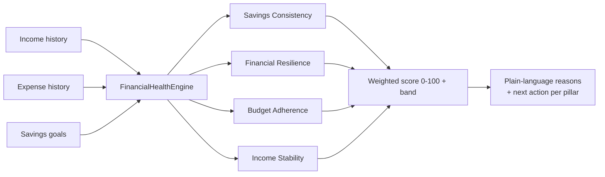
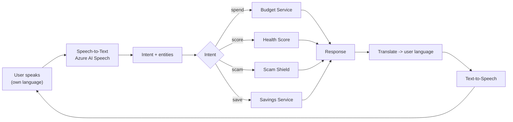
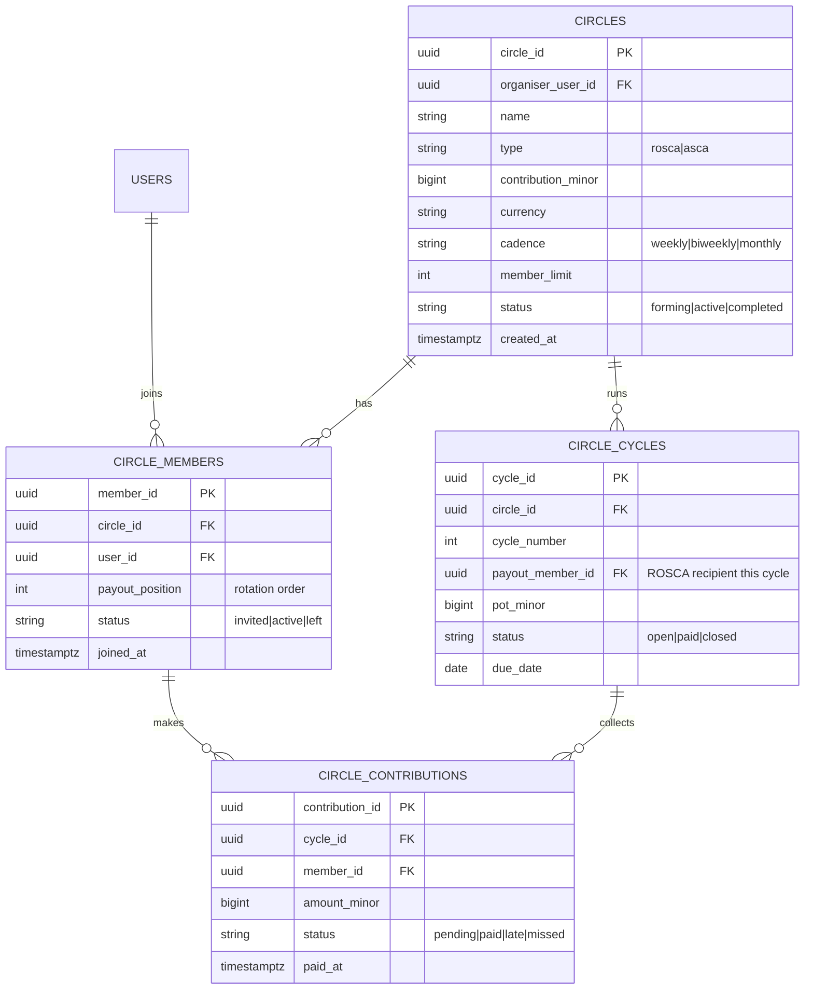

# 16 — Flagship Differentiators

Three capabilities that set MoneyMate apart for judges, users, and partners. Each is inclusion-first, reinforces the others, and maps to the core pains. Two are already implemented in the reference backend + web demo; the third is fully specified here for the next build phase.

| Differentiator | Why it matters | Status |
|---|---|---|
| 1. AI Financial Health Score | A credit score for the financially excluded — builds trust, not gatekeeping | **Built** (backend + demo) |
| 2. Voice-First Assistant | Removes the literacy & typing barrier entirely | **Built** (web demo via Web Speech; Azure Speech in prod) |
| 3. Community Savings Circles | Digitises trusted stokvels/chamas — social trust + retention | **Built** (backend; ROSCA lifecycle + guarded payout) |

---

## 1. AI Financial Health Score

An alternative to a credit score that rewards healthy **behaviour** rather than formal-credit history — so people with no bank record can still build a visible, improvable measure of financial health. It is a **confidence builder, not a gate**: every number is explained with a concrete way to improve it.

### The four pillars (each 0–100)

| Pillar | Weight | Measures | Example reason shown to user |
|---|---|---|---|
| **Savings Consistency** | 30% | How regularly & how much the user saves relative to income | "You've saved 22% of recent income across your goals. Regular small saves raise this." |
| **Financial Resilience** | 30% | Emergency buffer vs. monthly spend (target: 3 months) | "Your savings cover about 1.1 months of spending. Aim for 3 months." |
| **Budget Adherence** | 20% | Spending kept within predicted safe-to-spend | "You spent 78% of your recent income. Keeping some back lifts this." |
| **Income Stability** | 20% | Week-to-week income volatility (lower = higher score) | "Your income is uneven — MoneyMate smooths this with dynamic budgeting." |

Overall = weighted sum → band: **Getting started (<40) · Finding footing (40–59) · Building (60–79) · Thriving (80+)**.

### Why this design
- **Explainable (ADR-0006):** each pillar carries a plain-language reason and a next action — trust and coaching in one.
- **Fair & inclusive:** uses only the user's own behaviour, no third-party bureau data; works for the unbanked.
- **A growth loop:** a visible, improvable score drives engagement (users return to raise it) and, in Phase 3, becomes consented input to **alternative credit scoring** ([Feature #18](04-feature-list.md)) — unlocking fair credit for the excluded.
- **On-device capable:** the baseline engine needs no LLM, so it works offline; a trained model can refine weightings later behind the same contract.

### Implementation (reference backend)
- Module: `app.moneymate.health` — `FinancialHealthEngine`, `HealthService`, `HealthController`.
- Endpoint: `GET /v1/health-score` → overall score, band, four pillars with reasons, summary, model version.
- Reuses income/expense/goal data; no new storage required for the baseline.



---

## 2. Voice-First Financial Assistant

Voice is not a convenience add-on — for low-literacy users (personas Grace, Maria, Sipho) it is the **primary interface**. The assistant lets users *speak* to manage money, learn, and report scams in their own language.

### Capabilities
- **Voice budgeting** — "How much can I spend today?" → spoken safe-to-spend + reason.
- **Voice savings** — "How is my school-fees goal?" → progress read aloud.
- **Voice health score** — "How am I doing with money?" → score + encouragement.
- **Voice scam reporting** — "Check this message" → routes into Scam Shield; (prod) accepts forwarded audio/text.
- **Voice education** — audio-first lessons, answerable by voice ([Learning](03-user-journeys.md#journey-d--financial-learning-literacy-coach)).

### Architecture
- **Demo:** browser **Web Speech API** (`SpeechRecognition` + `speechSynthesis`) + an on-device intent matcher — zero cloud, works live.
- **Product:** **Azure AI Speech** (STT/TTS, multilingual) → `POST /v1/voice/intent` ([API §Voice](07-api-design.md#voice--ussd-endpoints)) → NLU intent + entities → the relevant service → spoken, localised response via **Azure AI Translator**.
- **Offline:** a small on-device command grammar handles the top intents without a connection.



### Implementation (reference demo)
Voice FAB + panel in the web app; `handleUtterance()` matches intents and calls the live APIs, then speaks the answer. Example chips provide a reliable fallback for noisy demo rooms or browsers without speech support.

---

## 3. Community Savings Circles (digitised stokvels / chamas / ROSCAs)

Informal savings groups — **stokvels** (South Africa), **chamas** (Kenya), **ROSCAs** worldwide — are how hundreds of millions already save. They work on social trust but suffer from cash risk, opaque bookkeeping, and fraud. MoneyMate digitises them **without destroying the social trust that makes them work**.

### How it works
A **Circle** is a group of members who contribute a fixed amount each cycle (e.g. R200/week). Each cycle the pooled pot pays out to one member in rotation (ROSCA model), or accumulates to a shared goal (ASCA model). MoneyMate adds transparency, reminders, fairness, and fraud protection.

### Key features
| Feature | Benefit |
|---|---|
| Transparent ledger | Every contribution & payout visible to all members — removes "where's the money?" distrust |
| Automated reminders & collection | Higher on-time contribution rates; less admin burden on the organiser |
| Fair rotation / payout schedule | Algorithmic, visible order — no favouritism disputes |
| Organiser & member roles | Clear permissions; organiser can't move money alone |
| Scam & fraud protection | Scam Shield + fraud rules guard against fake circles and organiser fraud |
| Partial / catch-up contributions | Affordability-aware (matches the income-volatility reality) |
| Social nudges & streaks | Group accountability → the strongest retention driver in fintech |

### Why it's a differentiator
- **Financial inclusion:** meets users where they already are (existing trusted behaviour) instead of imposing a new one.
- **Social trust → retention:** group commitment massively boosts engagement and D30/D90 retention — the hardest fintech metric.
- **Network growth loop:** each organiser recruits 5–15 members → built-in viral acquisition at near-zero CAC.
- **Data & credit:** consented circle behaviour strengthens the Health Score and alternative credit profile.

### Data model (extends [DB design](06-database-design.md))



### API sketch (extends [API design](07-api-design.md))
```
POST /v1/circles                      create a circle (organiser)
POST /v1/circles/{id}/members         invite / join
GET  /v1/circles/{id}                 circle detail + transparent ledger
POST /v1/circles/{id}/contributions   contribute to the current cycle
GET  /v1/circles/{id}/cycles          rotation schedule & payout history
POST /v1/circles/{id}/payout          release the pot (guarded, multi-condition)
```

### Build status (reference backend)
Implemented in `app.moneymate.circles`: create circle, join (auto rotation position), organiser-only start, fixed per-cycle contributions, and a **guarded payout** that is blocked until every active member has contributed and always pays the scheduled rotation recipient — so no single party (including the organiser) can divert funds. Every contribution and payout posts to the central transactions ledger. Endpoints: `POST /v1/circles`, `POST /v1/circles/{id}/members`, `POST /v1/circles/{id}/start`, `POST /v1/circles/{id}/contributions`, `POST /v1/circles/{id}/payout`, `GET /v1/circles`, `GET /v1/circles/{id}`. Verified end to end with a 3-member ROSCA. Remaining for production: escrow/settlement with a real payment rail, late/missed-contribution handling, and dispute resolution.

### Trust & safety notes
- Money movement uses the **transactions ledger** + **saga** pattern ([System Architecture](05-system-architecture.md)) with escrow so no single party (including the organiser) can divert funds.
- Payout release requires multiple conditions met (all contributions in or grace rules) — enforced server-side.
- Scam Shield + fraud detection screen for fake-circle and organiser-fraud patterns ([Security](09-security-architecture.md)).

---

**Related:** [Product Vision](01-product-vision.md) · [Feature List](04-feature-list.md) · [AI Module Design](08-ai-module-design.md) · [Business Model](14-business-model.md)
